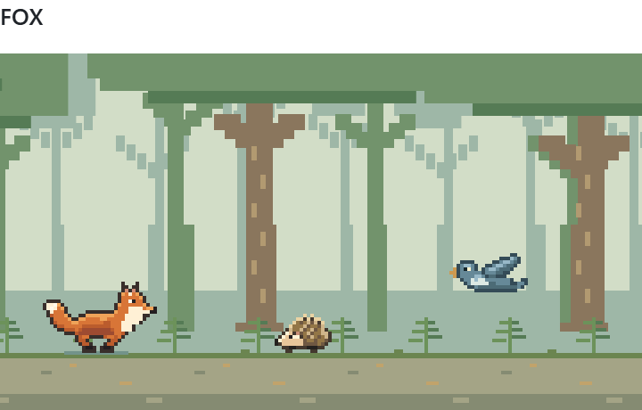
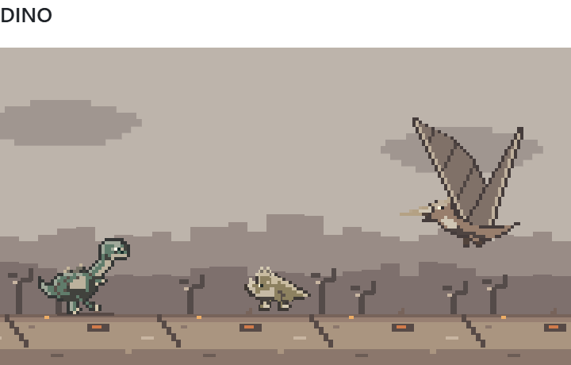
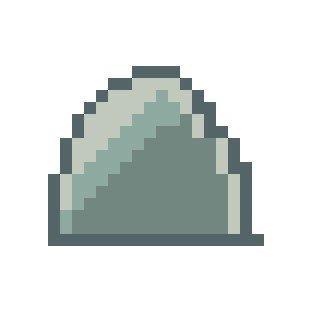
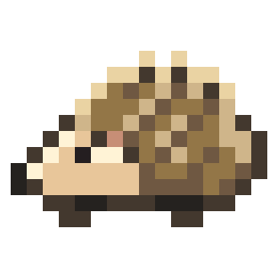
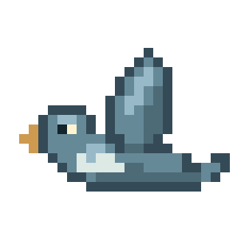
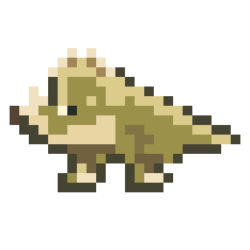
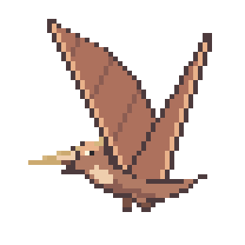
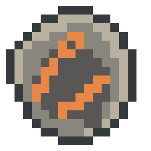

<h1 align="center">Fox / Dino Run</h1>

<p align="center">
  <strong>English (EN)</strong> &middot; <a href="README_DE.md">Deutsch (DE)</a>
</p>

<p align="center">
  A pixel runner with two characters and two worlds.<br>
  Reach 5,000 points. Then see how much further you can go.
</p>

<p align="center">
  <a href="#play-locally">Play locally</a> &middot;
  <a href="https://github.com/felix-henry/runner-game/releases/tag/v1.0.0">Release 1.0.0</a> &middot;
  <a href="#how-to-play">How to play</a> &middot;
  <a href="LICENSE.txt">MIT license</a>
</p>

<p align="center">
  <picture>
    <source media="(prefers-color-scheme: dark)" srcset="docs/readme-fox-dark.png">
    
  </picture>
  <picture>
    <source media="(prefers-color-scheme: dark)" srcset="docs/readme-dino-dark.png">
    
  </picture>
</p>

<p align="center"><sub>Original pixel art. Vanilla JavaScript and Canvas. No additional runtime packages.</sub></p>

## Two paths to Endless

- **Fox:** Jump over hedgehogs and rocks, duck under birds and reach your den. The forest awaits on the other side.
- **Dino:** Dodge land dinosaurs, pterosaurs and meteors. After the impact, continue through a ruined world.

Each character has its own obstacles, ending sequence and high score. Play with a keyboard, touch gestures or the buttons below the game. An illustrated guide is available in-game.

## Play locally

**Node.js 22 or newer is all you need. No `npm install` required.**

```sh
git clone https://github.com/felix-henry/runner-game.git
cd runner-game
npm run dev
```

Open **[127.0.0.1:8233](http://127.0.0.1:8233)** in your browser. The demo follows your system's light or dark theme.

Run `npm test` for the standalone checks. You can also start the demo directly with `node serve.mjs`; set the `PORT` environment variable to use a different port. The server only listens on your own computer.

## Controls

- **Jump:** <kbd>Space</kbd> or <kbd>↑</kbd>. On touch devices, tap or swipe up.
- **Duck:** Hold <kbd>↓</kbd>. On touch devices, swipe down or hold the duck button.
- **Double jump:** With Dino, jump, tap or swipe up again while airborne.
- **Pause:** <kbd>Esc</kbd> or the pause button.

Tap for a short jump; hold for a higher one. **Every jump needs a fresh key press, tap or swipe.** Holding a control does not trigger automatic bunny hopping.

The game UI is currently in German. Use **Fortsetzen** to resume, the restart button to start over, or **Nochmal** to try again after a collision. **Anleitung** opens the illustrated guide.

## How to play

Dodge the obstacles and reach **5,000 points**. Touching an obstacle ends your run. Collisions use the visible pixels of each sprite; transparent areas do not count.

<details>
<summary><strong>Obstacles, jumps and speed</strong></summary>

### What is coming your way?

| Obstacle                                                                                                   | Your move                                                                     |
| ---------------------------------------------------------------------------------------------------------- | ----------------------------------------------------------------------------- |
|  **Rocks** · both characters            | **Jump.** Ducking will not help.                                              |
|  **Hedgehog** · Fox             | **Jump over it** in time.                                                     |
|  **Bird** · Fox                         | Stay on the ground and **duck** until it passes.                              |
|  **Land dinosaur** · Dino | **Jump over it.**                                                             |
|  **Pterosaur** · Dino         | **Duck.** Even a double jump will not clear it.                               |
|  **Meteor** · Dino                  | **Double jump:** take off, then trigger the second jump while still airborne. |

Fox has one jump. Only Dino can dodge meteors with two deliberate jumps. Holding a control triggers neither repeated jumps nor a double jump. The arrow buttons remain available alongside touch gestures; swiping down makes the character duck briefly.

Meteors appear in Dino mode **from 250 points**. At higher speeds, from around **1.75x**, the encounter briefly slows down so you can time the double jump. This assistance does not apply to pterosaurs.

### How speed increases

- **0 to 5,000 points:** a steady increase from 1x to 1.75x, starting immediately.
- **5,000 to 7,500 points:** from 1.75x to 2x.
- **7,500 to 10,000 points:** from 2x to 2.25x.
- **Above 10,000 points:** capped at 2.25x.

The curve is the same for both characters on phones and desktops. Movement and jumps speed up together. Jump height does not increase. Meteors still begin at 250 points; this is separate from the speed curve.

### Character selection and pausing

Choose **Fox or Dino** before starting, while paused or after a run. Switching characters starts a fresh round. The selector is locked while running and during the ending and return sequences.

Opening the guide pauses the game and releases held inputs. Closing it with the cross, Escape or a click outside **does not automatically resume play**. Losing focus, switching to another tab or scrolling the game out of view also pauses the run.

</details>

<details>
<summary><strong>The goal, Endless and your high scores</strong></summary>

### Reaching the goal

Before **5,000 points**, the track clears: the last obstacle leaves the screen normally rather than disappearing when you reach the goal. You remain in control until the target score. The game then takes over, slows the character down and plays the ending **without awarding extra points**.

- **Fox:** The fox walks to the tree, lowers its head and disappears into its den beneath the roots.
- **Dino:** A large meteor approaches, hits the track and destroys the landscape. This is the normal ending, not a player mistake.

The message **Du hast das Ziel erreicht!** means **"You have reached the goal!"**. Choose **Endless starten** to continue. The goal is 5,000 points in both the local demo and the website integration.

### Keep going?

Endless starts at **5,000 points**, with no further score limit. The return animation does not award points. Speed eases in at **1.5x** and smoothly joins the current score-based pace over the first **six seconds of active play**, then continues toward 2x at 7,500 points and 2.25x at 10,000. Pausing and cutscenes do not advance this warmup. Dino's meteor slow motion still applies once the current pace reaches 1.75x.

- **Fox:** It emerges from the other side of the tree. During its return, the background smoothly transitions into a forest.
- **Dino:** It is revived. The landscape stays ruined, and Dino, land dinosaurs and pterosaurs have soot and ash markings. Their animations, sizes and collision pixels remain unchanged.

Obstacles and controls keep the same rules. After a collision, **Nochmal** starts a normal run **from zero**, not another Endless run. The restart button also starts a normal round. A new Dino run restores the original colors and undamaged landscape.

### Your high scores stay with you

Fox and Dino have **separate high scores**, stored only in your browser's Local Storage:

- `felixhenry-fox-highscore`
- `felixhenry-dino-highscore`

**No cookies are set and no scores are sent to a server.** If Local Storage is blocked, the record only lasts for the current page session. Browser origins have separate storage: the demo on port 8233 does not share its records with felixhenry.de. On the website, the 404 page and Runner detail page do share the same records.

</details>

<details>
<summary><strong>Technical details, files and website integration</strong></summary>

### One game component, multiple integrations

```text
runner-game/
  characters/    Characters, original artwork and high-score keys
  engine.js      Game rules and pixel collisions
  sprites.js     Shared artwork and pixel masks
  scene.js       Worlds and animations
  game.js        Inputs and browser integration
  markup.html    Shared controls and guide
  runner.css     Game and guide styles
assets/          Control icons and guide illustrations
docs/            Preview images for the READMEs only
```

The shared [game template](runner-game/markup.html) is used by both the demo and the website build. Its character-neutral `runner-*` controls use relative `assets/` paths, with no dependency on the website's 404 directory. `index.html`, `demo.css`, `demo.js` and `serve.mjs` provide the standalone preview using those paths directly, without 404 aliases. The server only exposes the required files and license text, not Git metadata or website source files. No external website icon set is needed.

In the website repository, this source lives under `404/`. The error page `404/404.html` belongs only to the website repository. The game repository contains no website navigation, footer or error page.

The website build also embeds the same game at `/projekte/minigames/runner-game`. The `/projekte/minigames` overview links to each game's own page through tiles and does not load the game itself. Only the host build resolves the template's relative asset references to `/404/assets/`. It adds content hashes to CSS and JavaScript and copies [LICENSE.txt](LICENSE.txt) unchanged to `/404/LICENSE.txt`. The regular game page returns HTTP 200; unknown website addresses return HTTP 404. The overview and game page remain excluded from search indexing. The demo server, READMEs, README previews, tests and Git directories are not published with the website.

### Maintaining the documentation

The guide illustrations in [assets/](assets/) and README previews in [docs/](docs/) are rendered from the original sprites and scenes. Update these exports when the artwork changes. The guide overlay does not start its own animation loop.

When game rules change, update both README languages and the overlay guide in `runner-game/markup.html` so all integrations stay consistent.

</details>

## License

**MIT License · Copyright (c) 2026 Felix Henry.**

You may use, modify, redistribute and commercially use the game. Copies or substantial portions must retain the copyright notice and full license text. Visible attribution in the game UI is not required. The authoritative terms are in [LICENSE.txt](LICENSE.txt).

The license covers this game's code, original pixel art, control icons and documentation, **not the rest of felixhenry.de** or its photographs, texts and brand assets. No extracted Chromium runner is used.
