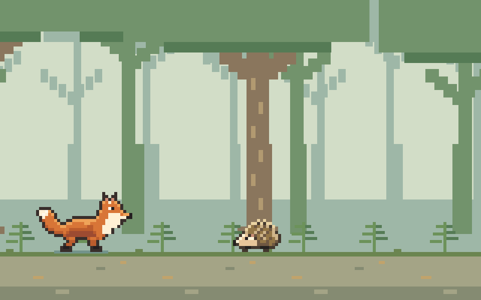
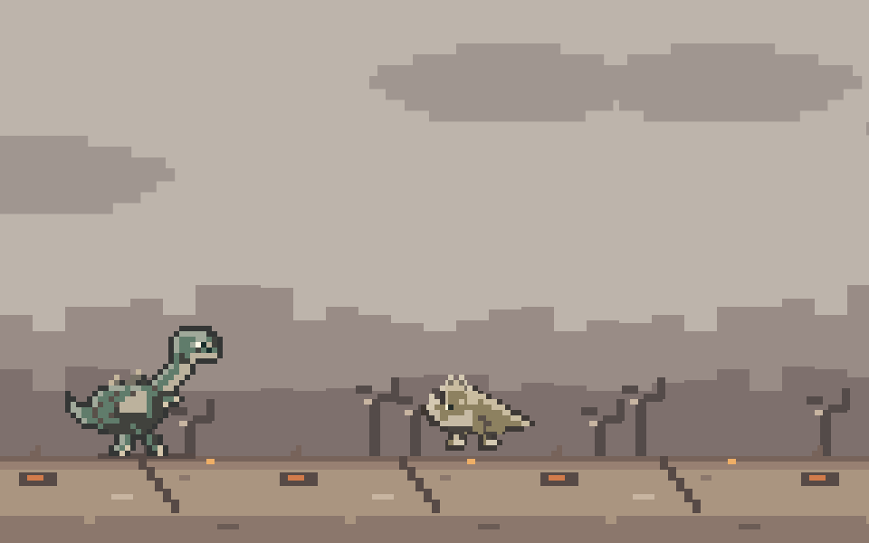

# Fox / Dino Run

Ein eigenständig entwickeltes Pixel-Minispiel mit Fuchs und Dino. Es wird auf felixhenry.de auf der 404-Seite und unter **Projekte / Minigames** eingebunden. Beide Seiten nutzen dieselbe Spielvorlage und dieselbe Logik; die Highscores werden im selben Browser gemeinsam verwendet. Der Textbutton **Anleitung** unter den Spielsteuerungen öffnet dieselben Regeln als Overlay mit den Originalgrafiken aller Hindernisse und Vorschauen der beiden Endless-Welten.

## Lokal starten

Voraussetzung: Node.js ab Version 22. Es sind keine Pakete zu installieren.

```sh
git clone https://github.com/felix-henry/runner-game.git
cd runner-game
npm run dev
```

Die Demo ist unter [127.0.0.1:8233](http://127.0.0.1:8233) erreichbar. Alternativ direkt `node serve.mjs` starten. Mit der Umgebungsvariable `PORT` kann ein anderer Port verwendet werden. `npm test` prüft Spielregeln und die Dateifreigabe der Demo. Der lokale Server bindet nur an den eigenen Rechner und gibt weder Git-Metadaten noch Website-Quelldateien aus.

Die Demo folgt dem hellen oder dunklen Systemdesign. Spielstände sind an den jeweiligen Browser-Ursprung gebunden; ein Rekord auf Port 8233 ist daher nicht derselbe wie auf felixhenry.de.

## Ziel

Weiche den Hindernissen aus und erreiche **5.000 Punkte**. Der Lauf wird nach und nach schneller. Eine Berührung mit einem Hindernis beendet ihn; transparente Bildbereiche zählen nicht als Kollision.

Das Ziel liegt sowohl lokal als auch auf der veröffentlichten Website bei **5.000 Punkten**. Endless startet anschließend ebenfalls bei 5.000 Punkten.

## Steuerung

| Aktion            | Tastatur                                                                                                | Touch und Buttons                                                                                  |
| ----------------- | ------------------------------------------------------------------------------------------------------- | -------------------------------------------------------------------------------------------------- |
| Springen          | Leertaste oder Pfeil nach oben. Kurz drücken für einen kleinen Sprung, länger halten für einen höheren. | Im Spielfeld tippen oder nach oben wischen; alternativ den oberen Pfeil-Button verwenden.          |
| Ducken            | Pfeil nach unten gedrückt halten.                                                                       | Nach unten wischen für kurzes Ducken oder den unteren Pfeil-Button gedrückt halten.                |
| Dino-Doppelsprung | Während des Sprungs erneut Leertaste oder Pfeil nach oben drücken.                                      | Noch in der Luft ein zweites Mal bewusst tippen, nach oben wischen oder den Sprung-Button drücken. |
| Pause             | Escape.                                                                                                 | Pause-Button.                                                                                      |
| Fortsetzen        | Den Button „Fortsetzen“ aktivieren.                                                                     | „Fortsetzen“ antippen.                                                                             |
| Neustart          | Den Neustart-Button aktivieren; nach einer Kollision auch „Nochmal“.                                    | Dieselben Buttons antippen.                                                                        |

Jeder Sprung braucht einen neuen Tastendruck, Wischer oder Tipp. Gedrückt halten löst weder automatische Folgesprünge noch den Dino-Doppelsprung aus. Der Fuchs hat nur einen Sprung.

**Fox oder Dino** wählst du vor dem Start, während einer Pause oder nach einem Lauf. Ein Wechsel beginnt eine neue Runde mit der ausgewählten Figur. Während des Laufens und der Schluss-/Rückkehranimationen ist der Wechsel gesperrt.

Beim Öffnen der Anleitung pausiert das Spiel und lässt gehaltene Sprung-/Duck-Eingaben los. Schließen mit Kreuz, Escape oder einem Klick außerhalb setzt es nicht automatisch fort. Auch Fokusverlust, ein versteckter Browser-Tab oder ein nicht mehr sichtbares Spielfeld pausieren den Lauf.

## Hindernisse

| Variante | Hindernis           | Was tun?                                                                                                       |
| -------- | ------------------- | -------------------------------------------------------------------------------------------------------------- |
| Beide    | Felsen              | Darüber springen. Ducken hilft nicht.                                                                          |
| Fox      | Igel am Boden       | Rechtzeitig darüber springen.                                                                                  |
| Fox      | Vogel auf Kopfhöhe  | Am Boden bleiben und ducken, bis er vorbei ist.                                                                |
| Dino     | Kleiner Landsaurier | Darüber springen.                                                                                              |
| Dino     | Flugsaurier         | Ducken. Auch der Doppelsprung hilft hier nicht.                                                                |
| Dino     | Fallender Meteorit  | Mit zwei bewusst ausgelösten Sprüngen ausweichen: abspringen und noch in der Luft den zweiten Sprung auslösen. |

Die Hindernisse in derselben Reihenfolge:


Meteoriten erscheinen im Dino-Modus ab 250 Punkten. Bei hohem Tempo, ab ungefähr 1,75-facher Geschwindigkeit, verlangsamt sich die Begegnung kurz. So lässt sich der Doppelsprung gezielt timen. Diese Hilfe betrifft nicht die Flugsaurier.

Das Tempo bleibt bis 250 Punkte bei 1x, steigt bis 1.000 Punkte auf 1,5x und bis 5.000 Punkte auf maximal 2,5x. Bewegungen und Sprünge werden im selben Verhältnis schneller; die Sprunghöhe wächst dadurch nicht.

## Das Ziel erreichen

Vor dem Ziel gibt es eine freie Strecke: Das letzte Hindernis verschwindet regulär aus dem Bild und wird nicht plötzlich entfernt. Bis zur Zielpunktzahl steuerst du selbst. Danach übernimmt das Spiel, bremst die Figur ab und spielt die Schlussanimation ohne zusätzliche Punkte ab.

- **Fox:** Der Fuchs läuft zum Baum, senkt den Kopf und verschwindet unter den Wurzeln in seinem Bau.
- **Dino:** Ein großer Meteorit nähert sich, trifft die Laufstrecke und zerstört die Landschaft. Das ist das reguläre Ende, kein Fehler des Spielers.

Danach erscheint „Du hast das Ziel erreicht!“ mit dem Button **Endless starten**. Das Spiel wartet auf deine Entscheidung.

## Endless

Erst mit **Endless starten** geht es weiter, ab 5.000 Punkten und ohne neues Punktelimit. Die Rückkehranimation selbst gibt keine Punkte. Das Tempo beginnt etwas sanfter bei 1,5x und steigt in den ersten sechs aktiven Spielsekunden wieder auf 2,5x.

- **Fox:** Der Fuchs kommt auf der anderen Seite des Baums aus dem Bau. Während seiner Rückkehr geht der Hintergrund fließend in einen Wald über.
- **Dino:** Der Dino wird wiederbelebt. Der zerstörte Hintergrund bleibt erhalten; der Dino, die kleinen Landsaurier und die Flugsaurier tragen Ruß- und Aschespuren. Ihre Animationen, Größen und Kollisionspixel bleiben unverändert.

Hindernisse und Steuerung behalten ihre Regeln. Nach einer Kollision beginnt **Nochmal** wieder einen normalen Lauf bei null, nicht einen weiteren Endless-Lauf bei 5.000 Punkten. Der Neustart-Button beginnt ebenfalls eine normale Runde. Ein neuer Dino-Lauf stellt die ursprünglichen Farben und die unversehrte Landschaft wieder her.




## Highscores

Fox und Dino haben getrennte Highscores. Sie bleiben nach einem Neustart erhalten und werden ausschließlich im Browser über Local Storage gespeichert:

- `felixhenry-fox-highscore`
- `felixhenry-dino-highscore`

Es werden dafür keine Cookies gesetzt und keine Spielstände an einen Server geschickt. Ist Local Storage gesperrt, bleibt der Rekord nur im Arbeitsspeicher der aktuellen Seite.

## Umsetzung und Vorschau

Die gemeinsame [Spielvorlage](runner-game/markup.html), die Spielstyles und die Spiellogik liegen in [runner-game/](runner-game/). `engine.js` enthält die Regeln, `sprites.js` die gemeinsamen Grafiken und Pixelmasken, `scene.js` zeichnet die Welt und `game.js` verbindet die Steuerung. Die beiden Figuren liegen in `runner-game/characters/`. Die Illustrationen für Overlay und README liegen in [assets/](assets/). Sie wurden aus den Original-Sprites und -Szenen exportiert und liegen jeweils passend zu Light- und Darkmode vor. Bei Änderungen an den Spielgrafiken auch diese Exporte aktualisieren. Das Overlay startet keine eigene Animation.

`index.html`, `demo.css`, `demo.js` und `serve.mjs` bilden die kleine eigenständige Vorschau. Der Server setzt die gemeinsame Spielvorlage ein und stellt nur die benötigten Spiel- und Bilddateien bereit. Die Vorlage nutzt für die eigenen Icons und Anleitungsbilder Pfade unter `/404/assets/`; der Demo-Server löst diese auf die lokalen Assets auf. Das Website-Iconset wird nicht benötigt.

Im Website-Repo liegt dieser Spiel-Quellcode unter `404/`. Die Fehlerseite `404/404.html` gehört nur zum Website-Repo und ist nicht Teil des eigenständigen Spiel-Repos. Der Website-Build setzt die Spielvorlage auch unter `/projekte/minigames` ein, versieht CSS und JavaScript mit Content-Hashes und veröffentlicht weder Demo-Server noch Tests oder Git-Verzeichnisse. Die reguläre Spielseite liefert HTTP 200, unbekannte Website-Adressen HTTP 404. Beide bleiben von der Suchindexierung ausgeschlossen.

Diese README bleibt im Repository und wird nicht nach `dist` kopiert. Änderungen an Regeln bitte sowohl hier als auch in der Overlay-Anleitung in `runner-game/markup.html` berücksichtigen. Alle Einbindungen erhalten dadurch denselben Stand.

## Rechte und Abhängigkeiten

Spielcode, Originalgrafiken, Bedien-Icons und Dokumentation dieses Spielprojekts stehen unter der [MIT-Lizenz](LICENSE.txt), Copyright (c) 2026 Felix Henry. Es wird kein extrahierter Chromium-Runner verwendet.

Du darfst das Spiel nutzen, verändern, weitergeben und auch kommerziell verwenden. Bei Kopien oder wesentlichen Teilen müssen der Copyright-Hinweis auf Felix Henry und der vollständige Lizenztext erhalten bleiben. Eine sichtbare Namensnennung in der Spieloberfläche ist nicht vorgeschrieben. Maßgeblich ist der englische Lizenztext in `LICENSE.txt`.

Diese Freigabe gilt für das eigenständige Spielprojekt, nicht für die übrige Website felixhenry.de oder deren Fotografien, Texte und Markenassets. Der Website-Build übernimmt den Spiel-Lizenztext unverändert nach `/404/LICENSE.txt`.

Auch die sechs Bedien-Icons in [assets/runner-icons.svg](assets/runner-icons.svg) sind eigenständig gezeichnete geometrische SVG-Symbole. Sie benötigen keine fremden Icondateien. Es gibt keine Browser- oder npm-Laufzeitabhängigkeiten.
