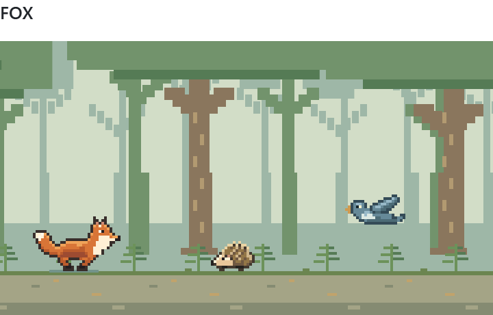
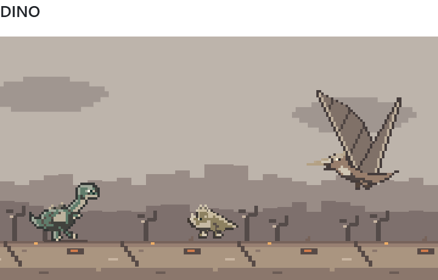
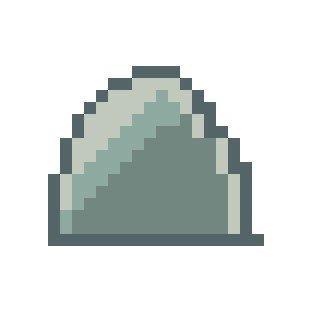
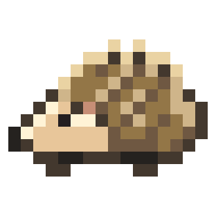
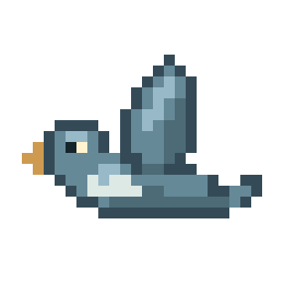
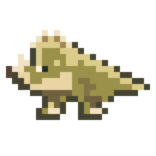
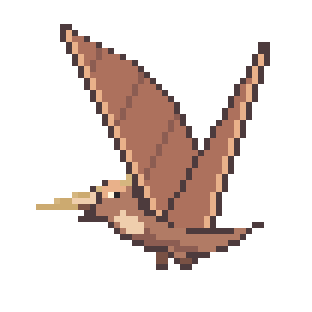
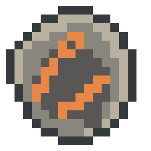

<h1 align="center">Fox / Dino Run</h1>

<p align="center">
  <a href="README.md">English (EN)</a> &middot; <strong>Deutsch (DE)</strong>
</p>

<p align="center">
  Ein Pixel-Runner mit zwei Figuren und zwei Welten.<br>
  Erreiche 5.000 Punkte. Entscheide dann, wie weit du noch kommst.
</p>

<p align="center">
  <a href="#lokal-spielen">Lokal spielen</a> &middot;
  <a href="https://github.com/felix-henry/runner-game/releases/tag/v1.0.0">Release 1.0.0</a> &middot;
  <a href="#spielanleitung">Anleitung</a> &middot;
  <a href="LICENSE.txt">MIT-Lizenz</a>
</p>

<p align="center">
  <picture>
    <source media="(prefers-color-scheme: dark)" srcset="docs/readme-fox-dark.png">
    
  </picture>
  <picture>
    <source media="(prefers-color-scheme: dark)" srcset="docs/readme-dino-dark.png">
    
  </picture>
</p>

<p align="center"><sub>Eigene Pixelgrafiken. Vanilla JavaScript und Canvas. Keine zusätzlichen Laufzeitpakete.</sub></p>

## Zwei Wege ins Endless

- **Fox:** Springe über Igel und Felsen, ducke dich unter Vögeln hindurch und erreiche deinen Bau. Dahinter wartet der Wald.
- **Dino:** Weiche Landsauriern, Flugsauriern und Meteoriten aus. Nach dem Einschlag geht es in einer zerstörten Welt weiter.

Beide Figuren haben eigene Hindernisse, Schlussanimationen und Highscores. Die Steuerung funktioniert mit Tastatur, Touch-Gesten und den Buttons unter dem Spielfeld. Eine bebilderte Anleitung ist direkt im Spiel verfügbar.

## Lokal spielen

**Node.js ab Version 22 genügt. Kein `npm install` nötig.**

```sh
git clone https://github.com/felix-henry/runner-game.git
cd runner-game
npm run dev
```

Öffne **[127.0.0.1:8233](http://127.0.0.1:8233)** im Browser. Die Demo folgt deinem hellen oder dunklen Systemdesign.

`npm test` führt die eigenständigen Prüfungen aus. Alternativ startet `node serve.mjs` die Demo direkt; mit der Umgebungsvariable `PORT` lässt sich der Port ändern. Der Server bindet nur an deinen eigenen Rechner.

## Steuerung

- **Springen:** <kbd>Leertaste</kbd> oder <kbd>↑</kbd>. Bei Touch tippen oder nach oben wischen.
- **Ducken:** <kbd>↓</kbd> halten. Bei Touch nach unten wischen oder den Ducken-Button halten.
- **Doppelsprung:** Beim Dino noch in der Luft erneut springen, tippen oder nach oben wischen.
- **Pause:** <kbd>Esc</kbd> oder Pause-Button.

Kurz springen für einen kleinen Sprung, länger halten für einen höheren. **Jeder Sprung braucht einen neuen Tastendruck, Tipp oder Wischer.** Kein automatisches Bunny-Hopping. Zum Fortsetzen, Neustarten oder für eine weitere Runde nutzt du die Spielbuttons.

## Spielanleitung

Weiche den Hindernissen aus und erreiche **5.000 Punkte**. Berührst du ein Hindernis, endet der Lauf. Die Kollision wird anhand der sichtbaren Pixel geprüft; transparente Bildbereiche zählen nicht.

<details>
<summary><strong>Hindernisse, Sprünge und Tempo</strong></summary>

### Was kommt dir entgegen?

| Hindernis                                                                                              | Deine Reaktion                                                                 |
| ------------------------------------------------------------------------------------------------------ | ------------------------------------------------------------------------------ |
|  **Felsen** · beide Figuren         | **Springen.** Ducken hilft nicht.                                              |
|  **Igel** · Fox                 | Rechtzeitig **darüber springen**.                                              |
|  **Vogel** · Fox                   | Am Boden bleiben und **ducken**, bis er vorbei ist.                            |
|  **Landsaurier** · Dino | **Darüber springen**.                                                          |
|  **Flugsaurier** · Dino | **Ducken.** Auch der Doppelsprung hilft nicht.                                 |
|  **Meteorit** · Dino          | **Doppelsprung:** abspringen und noch in der Luft den zweiten Sprung auslösen. |

Der Fuchs hat einen Sprung. Nur der Dino kann mit zwei bewusst ausgelösten Sprüngen den Meteoriten ausweichen. Gedrückt halten löst weder automatische Folgesprünge noch den Doppelsprung aus. Die normalen Pfeil-Buttons bleiben zusätzlich zu den Touch-Gesten verfügbar; ein Abwärtswischer duckt die Figur kurz.

Meteoriten erscheinen im Dino-Modus **ab 250 Punkten**. Bei hohem Tempo, ab ungefähr **1,75x**, wird die Begegnung kurz langsamer. So lässt sich der Doppelsprung gezielt timen. Diese Hilfe betrifft nicht die Flugsaurier.

### So steigt das Tempo

- Bis **250 Punkte:** 1x.
- Bis **1.000 Punkte:** gleichmäßig auf 1,5x.
- Bis **5.000 Punkte:** weiter auf maximal 2,5x.

Bewegungen und Sprünge werden im selben Verhältnis schneller. Die Sprunghöhe wächst dadurch nicht.

### Auswahl und Pause

**Fox oder Dino** wählst du vor dem Start, während einer Pause oder nach einem Lauf. Ein Wechsel beginnt eine neue Runde. Während des Laufens und der Schluss-/Rückkehranimationen bleibt die Auswahl gesperrt.

Beim Öffnen der Anleitung pausiert das Spiel und lässt gehaltene Eingaben los. Schließen mit Kreuz, Escape oder einem Klick außerhalb setzt es **nicht automatisch fort**. Auch Fokusverlust, ein versteckter Tab oder ein nicht mehr sichtbares Spielfeld pausieren den Lauf.

</details>

<details>
<summary><strong>Das Ziel, Endless und deine Highscores</strong></summary>

### Das Ziel erreichen

Vor **5.000 Punkten** gibt es eine freie Strecke: Das letzte Hindernis verschwindet regulär aus dem Bild, nicht plötzlich beim Erreichen des Ziels. Bis zur Zielpunktzahl steuerst du selbst. Danach übernimmt das Spiel, bremst die Figur ab und spielt die Schlussanimation **ohne zusätzliche Punkte** ab.

- **Fox:** Der Fuchs läuft zum Baum, senkt den Kopf und verschwindet unter den Wurzeln in seinem Bau.
- **Dino:** Ein großer Meteorit nähert sich, trifft die Strecke und zerstört die Landschaft. Das ist das reguläre Ende, kein Fehler des Spielers.

Danach erscheint **„Du hast das Ziel erreicht!“**. Erst mit **Endless starten** geht es weiter. Das Ziel liegt lokal und auf der Website bei 5.000 Punkten.

### Noch eine Strecke?

Endless beginnt bei **5.000 Punkten**, ohne neues Punktelimit. Die Rückkehranimation selbst gibt keine Punkte. Das Tempo startet sanfter bei **1,5x** und steigt in den ersten **sechs aktiven Spielsekunden** wieder auf **2,5x**.

- **Fox:** Er kommt auf der anderen Seite des Baums aus dem Bau. Während seiner Rückkehr geht der Hintergrund fließend in einen Wald über.
- **Dino:** Er wird wiederbelebt. Die Landschaft bleibt zerstört; Dino, Landsaurier und Flugsaurier tragen Ruß- und Aschespuren. Ihre Animationen, Größen und Kollisionspixel bleiben unverändert.

Hindernisse und Steuerung behalten ihre Regeln. Nach einer Kollision beginnt **Nochmal** wieder einen normalen Lauf **bei null**, keinen weiteren Endless-Lauf. Der Neustart-Button beginnt ebenfalls eine normale Runde. Ein neuer Dino-Lauf stellt Farben und unversehrte Landschaft wieder her.

### Highscores bleiben bei dir

Fox und Dino haben **getrennte Highscores**, gespeichert ausschließlich im Local Storage deines Browsers:

- `felixhenry-fox-highscore`
- `felixhenry-dino-highscore`

Es gibt dafür **keine Cookies und keine Übertragung an einen Server**. Ist Local Storage gesperrt, bleibt der Rekord nur im Arbeitsspeicher der aktuellen Seite. Browser-Ursprünge haben eigene Speicherbereiche: Die Demo auf Port 8233 teilt ihren Rekord nicht mit felixhenry.de. Auf der Website teilen 404-Seite und Minigames-Seite dagegen dieselben Rekorde.

</details>

<details>
<summary><strong>Technik, Dateien und Website-Einbindung</strong></summary>

### Eine Spielkomponente, mehrere Einbindungen

```text
runner-game/
  characters/    Figuren, Originalgrafiken und Rekord-Schlüssel
  engine.js      Spielregeln und Pixelkollisionen
  sprites.js     Gemeinsame Grafiken und Pixelmasken
  scene.js       Welten und Animationen
  game.js        Eingaben und Browser-Anbindung
  markup.html    Gemeinsame Steuerung und Anleitung
  runner.css     Spiel- und Anleitungsstyles
assets/          Bedien-Icons und Anleitungsbilder
docs/            Vorschaugrafiken nur für diese README
```

Die gemeinsame [Spielvorlage](runner-game/markup.html) wird sowohl von der Demo als auch vom Website-Build eingesetzt. `index.html`, `demo.css`, `demo.js` und `serve.mjs` bilden die eigenständige Vorschau. Der Server gibt nur die benötigten Dateien und den Lizenztext frei, weder Git-Metadaten noch Website-Quelldateien. Pfade unter `/404/assets/` werden dabei auf lokale Assets aufgelöst. Ein fremdes Website-Iconset wird nicht benötigt.

Im Website-Repo liegt dieser Quellcode unter `404/`. Die Fehlerseite `404/404.html` gehört nur zum Website-Repo. Das Spiel-Repo enthält keine Website-Navigation, keinen Footer und keine Fehlerseite.

Der Website-Build bindet dasselbe Spiel auch unter `/projekte/minigames` ein, versieht CSS und JavaScript mit Content-Hashes und übernimmt [LICENSE.txt](LICENSE.txt) unverändert nach `/404/LICENSE.txt`. Die reguläre Spielseite liefert HTTP 200, unbekannte Website-Adressen HTTP 404. Beide bleiben von der Suchindexierung ausgeschlossen. Demo-Server, README, README-Vorschauen, Tests und Git-Verzeichnisse werden nicht veröffentlicht.

### Dokumentation pflegen

Die Anleitungsbilder in [assets/](assets/) und die README-Vorschauen in [docs/](docs/) stammen aus den Original-Sprites und -Szenen. Bei Änderungen an den Grafiken auch die Exporte aktualisieren. Das Anleitungs-Overlay startet keine eigene Animation.

Änderungen an Spielregeln bitte in beiden README-Sprachversionen und in der Overlay-Anleitung in `runner-game/markup.html` berücksichtigen. So erhalten alle Einbindungen denselben Stand.

</details>

## Lizenz

**MIT License · Copyright (c) 2026 Felix Henry.**

Du darfst das Spiel nutzen, verändern, weitergeben und auch kommerziell verwenden. Bei Kopien oder wesentlichen Teilen müssen Copyright-Hinweis und vollständiger Lizenztext erhalten bleiben. Eine sichtbare Namensnennung im Spiel ist nicht vorgeschrieben. Maßgeblich ist [LICENSE.txt](LICENSE.txt).

Die Lizenz umfasst Code, eigene Pixelgrafiken, Bedien-Icons und Dokumentation dieses Spielprojekts, **nicht die übrige Website felixhenry.de** oder deren Fotografien, Texte und Markenassets. Es wird kein extrahierter Chromium-Runner verwendet.
